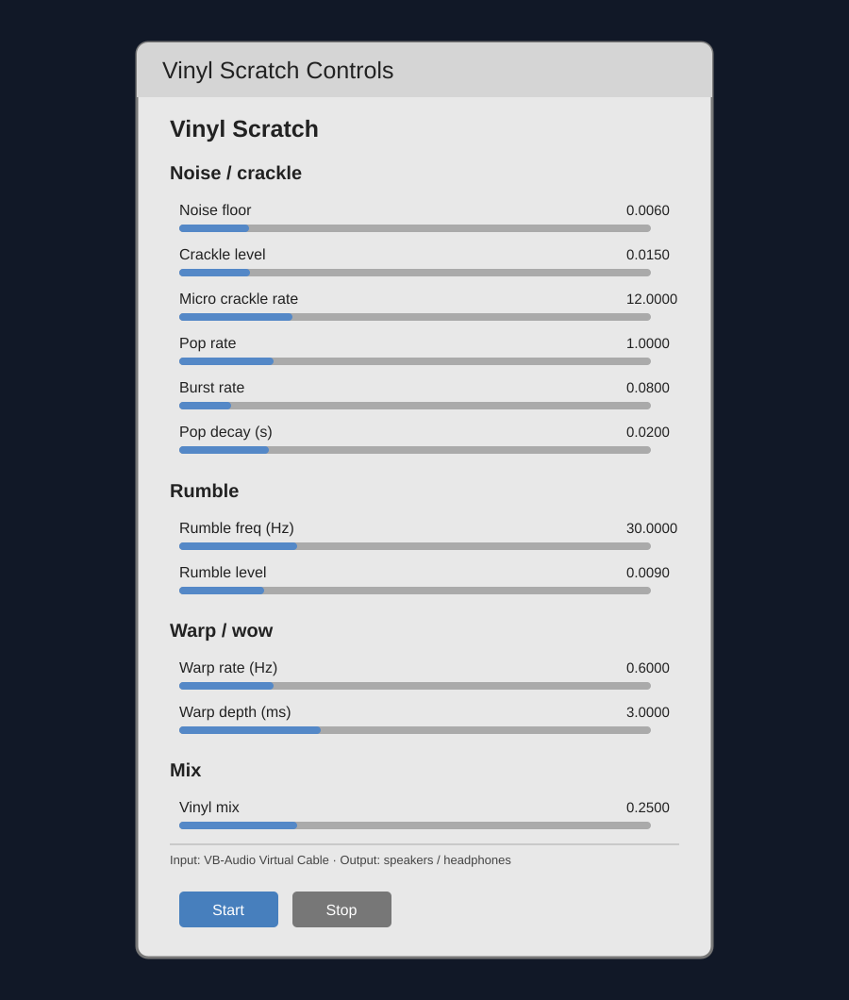

# Vinyl Scratch

**License: GNU General Public License v3.0 only (GPL-3.0-only).** See [LICENSE](LICENSE).

Vinyl Scratch is a small, real-time stereo audio effect. It passes audio from a selected input to an output while adding adjustable record-style hiss, crackle, pops, rumble, and gentle wow/flutter. A Dear PyGui control window lets you change the effect while it runs.

## What you need

- [Python 3.10 or newer](https://www.python.org/downloads/)
- [NumPy](https://numpy.org/)
- [sounddevice](https://python-sounddevice.readthedocs.io/) and a working [PortAudio](https://www.portaudio.com/) audio backend
- [Dear PyGui](https://dearpygui.readthedocs.io/)
- An audio input and output that your operating system can open

Install the pinned Python packages in a terminal:

```console
python -m pip install -r requirements.txt
```

On Windows, the included automatic input selection expects an input device whose name contains `CABLE Output (VB-Audio Virtual `, typically provided by [VB-Audio Virtual Cable](https://vb-audio.com/Cable/). Install and configure that cable separately if you want to use this default routing. The output selection looks for a device containing `Speakers` or `Headphones`, then falls back to the system's default output.

## Run it

From the folder containing the script:

```console
python vinyl_scratch_ui.py
```

In the control window, select **Start** to begin processing and **Stop** to stop. Audio from the selected input is sent to the selected output with the vinyl layer mixed in. Close the window to exit.

## Sample setup

For a Windows setup using [VB-Audio Virtual Cable](https://vb-audio.com/Cable/):

1. Install VB-Audio Virtual Cable and make the audio you want to process play to the cable's playback endpoint.
2. Connect the cable's recording endpoint (`CABLE Output`) to this program's input. The script searches device names for that text.
3. Choose speakers or headphones as the Windows output device. The script picks the first matching device, or uses the default output if neither name is found.
4. Start Vinyl Scratch and press **Start**. Adjust **Vinyl mix** first, then tune the noise and warp sliders to taste.

Use headphones at a low volume when first checking the routing. Avoid routing the output back into the input, which can create feedback.

## Controls

The sliders adjust these live parameters:

- **Noise / crackle:** noise floor, crackle level, micro-crackle rate, pop rate, burst rate and length, pop amplitude range, and pop decay.
- **Rumble:** rumble frequency and level.
- **Warp / wow:** modulation rate and delay depth.
- **Mix:** vinyl noise added to the input signal.

The defaults and audio engine settings are at the top of `vinyl_scratch_ui.py`. They include sample rate (44.1 kHz), stereo channel count, block size (4096 frames), and latency. Device name matching is configured by `INPUT_NAME_SUBSTR` and `OUTPUT_NAME_SUBSTRS`. If your devices have different names, change those values to match your system.

## Screenshot

Illustrative preview of the controls window (the actual window is created when the program starts):



## Technical notes

- The application uses a full-duplex `sounddevice.Stream` callback with float32 audio.
- Input is converted to two channels as needed. A short, interpolated delay line applies the wow effect; generated noise is mixed in according to **Vinyl mix**.
- Noise, rumble, crackle, pops, and bursts are generated in blocks. A soft saturator limits harsh peaks, and the callback applies additional peak scaling above 0.99.
- The stream runs on a daemon thread so the Dear PyGui event loop remains responsive. Audio status and startup errors are printed to the terminal.
- Device selection is currently automatic and based on name fragments; this may select the first matching device when several devices match.

## Troubleshooting

- **No input device found:** check that the virtual cable or input device is connected and that its name contains the configured input fragment.
- **No output or audio start failure:** check the operating-system audio device, sample-rate support, and device permissions. Try a smaller `BLOCK_SIZE` if the audio backend reports latency or buffer problems.
- **Choppy audio:** close other audio-heavy applications, verify the selected devices support 44.1 kHz stereo, or increase the block size (at the cost of latency).
- **Too much noise or distortion:** lower **Vinyl mix**, **Noise floor**, and **Crackle level**.

## License

This project is licensed under the GNU General Public License, version 3 only. The SPDX identifier is `GPL-3.0-only`; the license text is available at <https://www.gnu.org/licenses/gpl-3.0.txt>.
